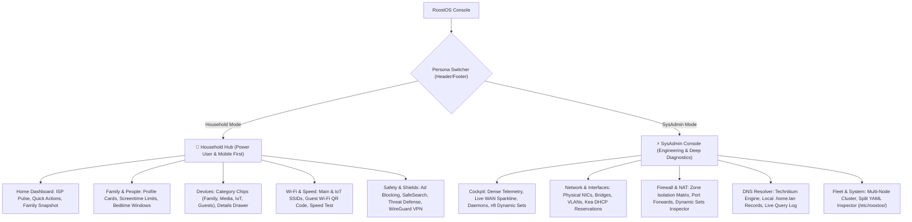
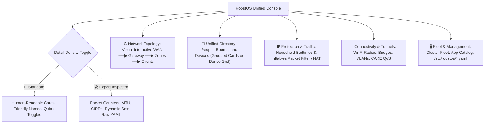
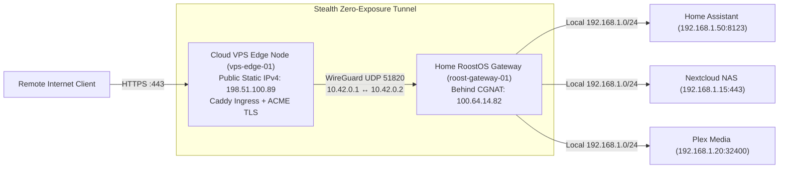
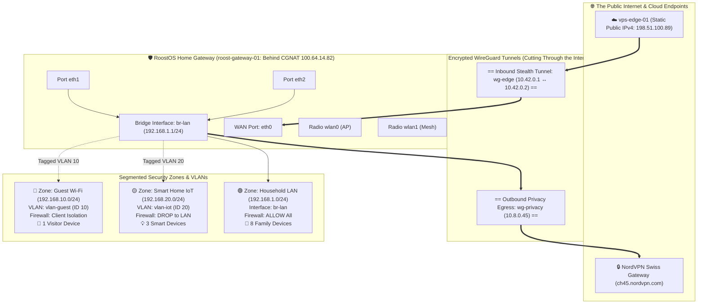

# RoostOS UI/UX Architecture & Redesign Proposals

## Executive Summary & Problem Analysis

RoostOS is an open-source, family-oriented operating system built on Ubuntu Server, integrating low-level Linux networking binaries (**Kea DHCP**, **nftables**, **systemd-networkd**, **IWD Mesh**, **Technitium DNS**, and **WireGuard**) with household management (**Parental Controls**, **Screentime**, **Bedtimes**, and **Edge Gateways**).

### Why the Current UI Feels "Clunky & Thrown Together"
1. **Flat Jargon Overload**: The current sidebar presents 15 raw system concepts (`br0`, `CAKE diffserv4`, `vlan-guest 10`, `nftables chains`, `Kea scopes`, `systemd units`) alongside household settings (`People`, `Locations`, `Devices`). A non-sysadmin parent looking to pause Wi-Fi or check screen time is overwhelmed by low-level networking parameters.
2. **Fragmented Domain Objects**: In a home network, a **Person** (e.g. *Alice*) owns **Devices** (*iPad*), which reside in **Locations** (*Kids Bedroom*) and have **Schedules** (*Bedtime 8:30 PM*). In the current UI, these are 4 separate siloed pages with disconnected tables.
3. **Desktop-Only Fixed Sidebar**: The current sidebar is fixed at `260px` with no mobile drawer, bottom navigation bar, or touch targets. On an iPhone or Android phone, tables break viewport boundaries.
4. **Shallow "Basic vs Advanced" Tabs**: Arbitrary basic/advanced subtabs hide random settings without a coherent mental model.

---

## Two Proposed Site Maps & Design Paradigms

To address these challenges, we have designed and fully stubbed out **two distinct architectural proposals** in a working interactive prototype with fake data.

---

### Concept 1: "Dual-Persona Adaptive Architecture"



#### Philosophy & Target Audience
* **Household Hub**: Clean, zero-jargon, tactile experience tailored for smartphones and tablets. Focuses on daily life: *"Is the internet fast?", "Who is online?", "Pause kids for dinner", "Give Alice +30m screentime", "Share Guest Wi-Fi QR"*.
* **SysAdmin Console**: Dense, telemetry-rich engineering workbench. Exposes raw NIC speeds, MTU, CAKE QoS bufferbloat tuning, Kea DHCP static reservations, nftables dynamic sets (`@quarantined`, `@schedule_blocked`), Technitium DNS query logs, and split YAML files.
* **Persona Switcher**: 1-click switcher in the top bar and mobile navigation.

#### Mobile UX
* Sticky bottom navigation bar with 5 thumb-friendly items: `[🏡 Home]`, `[👨‍👩‍👧 Family]`, `[📱 Devices]`, `[📶 Wi-Fi]`, `[🛡️ Safety]`.
* Quick Action cards (Dinner Time, +30m screentime, Guest QR) with large touch targets.
* Slide-over detail drawer for client diagnostics (signal dBm, IP, Rx/Tx throughput).

---

### Concept 2: "Unified Layered Topology" (Progressive Disclosure)



#### Philosophy & Target Audience
* Avoids splitting the application into two separate personas. Instead, a single unified architecture organizes the system by **Domain & Scope**.
* **Progressive Disclosure**: Every page has high-level status by default, with a global **"Expert Inspector"** toggle in the header that instantly exposes raw technical metrics, packet counters, and low-level parameters in-place without page reloading.
* **Interactive Topology Canvas**: A visual network flow graph linking `[Internet (WAN)]` ──▶ `[RoostOS Router]` ──▶ `[Household LAN | IoT | Guest Zones]` ──▶ `[Client Devices]`. Clicking any zone immediately filters the view to that network segment.

---

## Advanced Architecture: Edge Gateway (CGNAT Bypass) & Multi-Node Cluster Fleet

Residential internet connections are increasingly placed behind **Carrier-Grade NAT (CGNAT)** (e.g. T-Mobile Home Internet, Starlink, fiber ISPs), allocating private RFC6598 addresses (`100.64.0.0/10`) with zero inbound port forwarding. Furthermore, RoostOS is designed as a **distributed operating system** where duties can be split across multiple physical nodes.

### 1. Edge Gateway & CGNAT Bypass Architecture



#### How this is presented to each persona:
* **In Household Hub (Power User)**:
  * Displayed under **Safety & Remote Access** as a clean status card: *"Remote Access & Cloud Edge Relay"*.
  * Shows friendly domain links (e.g. `https://ha.smithfamily.net`, `https://cloud.smithfamily.net`) with green padlock icons (`🔒 Let's Encrypt Valid`) and 1-tap toggles to enable/disable external sharing.
  * Zero networking jargon: users don't need to know what CGNAT, CIDRs, or WireGuard keys are.
* **In SysAdmin Console & Expert Mode**:
  * Displayed as a dedicated **Edge Ingress & CGNAT Bypass** panel:
    * **Stealth WireGuard Tunnel**: Endpoint, latency (12ms), handshake timer, and traffic (48.2 GB Rx / 12.6 GB Tx).
    * **CGNAT Diagnostic**: Carrier WAN IP (`100.64.14.82`) vs VPS Public Static IPv4 (`198.51.100.89`).
    * **Ingress Domain Reverse Proxy Table**: Public hostnames mapped to private LAN IPs and ports with certificate renewal countdowns.
    * **Zero-Exposure Token Generator**: Support for importing `roost-edge-wg://` tokens or JSON bundles.

---

### 2. Multi-Node Cluster Fleet Network Settings

In a distributed RoostOS home deployment, there are typically multiple specialized nodes:
1. **`roost-gateway-01` (Edge Gateway Router)**: Protectli Vault running packet filtering (`nftables`), DHCP server (`Kea`), Wi-Fi mesh backhaul (`IWD`), and routing.
2. **`roost-controller-01` (Controller & App Node)**: Dell Micro / Home server running the central YAML domain engine (`roostos-engine`), MQTT broker (`mosquitto`), and container workloads (`technitium-dns`, `docker`).
3. **`living-room-ap` (Mesh Satellite)**: Dedicated Wi-Fi 6 access point running 802.11s wireless mesh.
4. **`vps-edge-01` (Cloud Relay)**: Cloud VPS providing the public static IP.

#### How users inspect and control network settings across all cluster nodes:
* **Cluster Fleet Node Selector**:
  * Instead of a flat single-machine assumption, both the **Network** and **Fleet** tabs provide a **Fleet Node Filter Bar**:
    ```text
    [ 🌐 All Fleet Nodes (4) ]  [ 🛡️ roost-gateway-01 ]  [ 🖥️ roost-controller-01 ]  [ 📶 living-room-ap ]  [ ☁️ vps-edge-01 ]
    ```
  * Selecting any node immediately scopes the interface table to that specific host's hardware adapters:
    * E.g., `roost-controller-01` shows `enp3s0` (LAN) and `docker0` (Container bridge `172.17.0.1/16`).
    * E.g., `living-room-ap` shows `eth0` (PoE Mesh Backhaul) and dual Wi-Fi 6 radios (`wlan0` 5GHz, `wlan1` 2.4GHz).
    * E.g., `vps-edge-01` shows `eth0` (10 Gbps Cloud Public Static) and `wg-edge` (WireGuard Ingress).
* **Interactive Topology Node Drill-Down (Concept 2)**:
  * In the **Network Topology Map**, each physical node in the fleet is rendered as an interactive node spanning from the Cloud VPS across the CGNAT boundary down to local mesh satellites.
  * Clicking on any node in the topology immediately brings up that host's **Hardware Telemetry** (CPU %, RAM %, Temp, uptime, systemd units) and its **Physical/Virtual Network Adapters Table**.

### 3. Interactive Network Zones, Interface Connections & Animated VPN Tunnels Diagram

A visual architecture diagram bridges the gap between physical adapters, virtual bridges, VLANs, and cloud encryption tunnels:



#### Diagram Features in the Prototype:
1. **Animated VPN Tunnel Packet Flow**: The WireGuard tunnels (`wg-edge` and `wg-privacy`) display real-time SVG animated dash-array flows cutting across the public internet boundary into the physical gateway.
2. **Interface Port Binding**: Visually illustrates how physical ports (`eth1`, `eth2`) are aggregated into the `br-lan` bridge, and how 802.1Q tagged subinterfaces (`vlan-iot`, `vlan-guest`) carve out isolated zones.
3. **Firewall Isolation Barriers**: Color-coded security zones explicitly denote firewall traversal policies (e.g. `DROP to Household LAN` on the IoT zone).
4. **Interactive Element Inspector**: Clicking on any zone, port, or VPN tunnel in the SVG diagram immediately displays an inspector card below with IP allocation, encryption cipher, transfer throughput, and nftables rules!
5. **Integrated in Both Options**:
   - **In Concept 1**: Available in both personas — as `🗺️ Network Map` in the Household Hub (with a direct link card on the Home dashboard), and as `🗺️ Topology & Zones` in the SysAdmin Console (plus a toggle inside the Cockpit telemetry view).
   - **In Concept 2**: Serves as the primary landing hub under `🌐 Topology`, pairing the interactive SVG Zone diagram with the Multi-Node Cluster Mesh map.

---

### 4. Multi-Network DHCP Scopes & Dynamic Pools (ISC Kea 2.4)

Each network zone requires its own DHCP scope, pool range, lease lifecycle, host node assignment, and DNS options:

```text
┌────────────────────────────────────────────────────────────────────────────────────────┐
│ 🎛️ DHCP Scopes & Node Assignments                                                      │
├──────────────────┬───────────────────────┬────────────┬──────────────────┬─────────────┤
│ Network Scope    │ Authoritative Node    │ Interface  │ Gateway IP       │ Dynamic Pool│
├──────────────────┼───────────────────────┼────────────┼──────────────────┼─────────────┤
│ 🟢 Household LAN │ 🛡️ roost-gateway-01   │ br-lan     │ 192.168.1.1      │ .100 - .250 │
│                  │   (HA: controller-01) │            │                  │             │
│ 🔵 Guest Wi-Fi   │ 🛡️ roost-gateway-01   │ vlan-guest │ 192.168.10.1     │ .50 - .200  │
│ 🟡 Smart Home IoT│ 🛡️ roost-gateway-01   │ vlan-iot   │ 192.168.20.1     │ .100 - .240 │
│ 🧪 Lab / Docker  │ 🖥️ roost-controller-01│ docker0    │ 172.17.0.1       │ .10 - .200  │
└──────────────────┴───────────────────────┴────────────┴──────────────────┴─────────────┘
```

#### Where & How DHCP is Configured Across the Application:
1. **SysAdmin Console (`📡 DHCP` Tab)**:
   - Dedicated top-level navigation item in the header and mobile bottom bar.
   - **Cluster Fleet Node Filter**: Filter scopes and telemetry by node (`All Fleet Nodes`, `roost-gateway-01`, `roost-controller-01`).
   - **Per-Network Scope Table**: Displays all subnets with an **"Edit"** button on each row that replaces the row in-place with inline inputs for host node binding, HA failover mode, gateway, dynamic pool start/end, lease duration dropdown (`2h`, `12h`, `24h`, `7d`), and status toggle.
   - **Top & Bottom `+ Add Network Scope` Buttons**: Inserts a temporary inline row form at the top/bottom matching the edit inputs (`AGENTS.md` compliant).
   - **Active Dynamic Leases Table**: Filterable by network with a 1-click **"📌 Convert to Static"** button that instantly binds a dynamic lease as a permanent MAC reservation!
   - **Static DHCP Reservations**: MAC-to-IP binding table with top/bottom `+ Add Reservation` buttons and inline editing.
2. **Concept 1 Cross-Links**:
   - **In Network (`🔌 Network`)**: Dedicated status card linking directly to `Configure DHCP Scopes →`.
   - **In Household Hub (`📶 Wi-Fi`)**: Friendly summary of local IP ranges (`192.168.1.100 - 250`, 24h lease) with a one-click button to jump to full DHCP configuration.
3. **Concept 2 (`🔌 Connect` & `🌐 Topology`)**:
   - In **Connect (`c2-connectivity.js`)**: Dedicated DHCP Scopes section with host node selectors and inline edit/add buttons.
   - In **Topology Diagram (`c2-zone-svg.js`)**: Clicking any zone or bridge (`br-lan`, `zone-lan`, `zone-iot`, `zone-guest`) reveals the active DHCP pool summary in the inspector card and provides a direct **"Configure DHCP →"** button.

---

### 5. Recently Blocked Requests & Live Threat Feed

Users and administrators need immediate visibility into *what* was blocked, *which device* requested it, *why* it was blocked, and *how to unblock or adjust it*:

```text
┌─────────────────────────────────────────────────────────────────────────────────────────┐
│ 🚫 Recently Blocked Requests & Protection Feed                                          │
├─────────┬──────────────────────┬─────────────────────────┬───────────────┬──────────────┤
│ Time    │ Client Device        │ Blocked Target          │ Subsystem     │ Quick Action │
├─────────┼──────────────────────┼─────────────────────────┼───────────────┼──────────────┤
│ 2m ago  │ 💻 Dad's Work Mac    │ adservice.google.com    │ DNS Sinkhole  │ [Allow]      │
│ 5m ago  │ 📱 Alice's iPad 10   │ tiktokv.com             │ TimeGuard     │ [+30m Bonus] │
│ 8m ago  │ 📺 Apple TV 4K       │ telemetry.samsung.com   │ DNS Sinkhole  │ [Allow]      │
│ 15m ago │ ❓ Unknown Galaxy S23│ 192.168.1.1:80 (Web UI) │ nftables      │ (Quarantine) │
│ 26m ago │ 🌐 External WAN Probe│ WAN eth0:22 (SSH)       │ nftables      │ (Port Scan)  │
│ 52m ago │ 🧊 Smart Fridge      │ 192.168.1.15:443 (NAS)  │ nftables (IoT)│ (VLAN Drop)  │
└─────────┴──────────────────────┴─────────────────────────┴───────────────┴──────────────┘
```

#### Multi-Subsystem Threat Correlation:
1. **DNS Sinkhole (Ad-Block & Telemetry)**:
   - Captures domains blocked by Technitium / blocklists (`StevenBlack`, `SmartTV Telemetry`).
   - Offers an instant **"Allow / Whitelist"** button that unblocks the domain network-wide.
2. **Parental Controls & Bedtimes (`timeguardd`)**:
   - Surfaces apps and social media blocked during kid bedtime windows or screentime caps.
   - Offers a 1-tap **"+30m Bonus"** button that temporarily extends screentime and unpauses the child's device.
3. **Kernel Firewall Drops (`nftables`)**:
   - Displays external WAN port scan probes dropped at the perimeter (`input_wan drop`).
   - Displays quarantined unregistered devices attempting to access router administration ports.
   - Displays Smart Home IoT devices attempting unauthorized lateral movement to the home LAN (`forward_iot_to_lan drop`).

#### Where It Appears in the Prototype:
* **In Concept 1 Household Hub**: Integrated directly into **`🛡️ Safety`** and featured as a live status card on **`🏡 Home`**.
* **In Concept 1 SysAdmin Console**: Integrated into **`🔍 DNS`** (replacing static query logs with live filter pills).
* **In Concept 2 Unified Topology**: Integrated into **`🛡️ Protection`**, supporting both standard friendly cards and expert dense tables.

---

## Comparison Matrix

| Feature / Dimension | Concept 1: Dual-Persona Architecture | Concept 2: Unified Layered Topology |
| :--- | :--- | :--- |
| **Primary Mental Model** | Two dedicated workspaces: Household vs Sysadmin | Single unified system with progressive density |
| **Household User Experience** | ⭐⭐⭐⭐⭐ Zero jargon, 100% focused on family and Wi-Fi | ⭐⭐⭐⭐ Friendly default view with topology map |
| **SysAdmin Experience** | ⭐⭐⭐⭐⭐ Full cockpit dashboard with dense telemetry | ⭐⭐⭐⭐ Toggle reveals expert columns and drawers |
| **Mobile Ergonomics** | ⭐⭐⭐⭐⭐ Native bottom navigation and quick actions | ⭐⭐⭐⭐ Responsive topology and segmented directory |
| **Context Switching** | Explicit toggle between Hub and Console | Seamless in-page expansion via Expert toggle |
| **Learning Curve** | Extremely low for family members | Low, with visual graph showing network flow |

---

## Strict Compliance with RoostOS UI Design Rules (`AGENTS.md`)

Both concepts fully implement all rules specified in `.agents/AGENTS.md`:

1. **No Persistent Add Forms**:
   - Zero permanent "Add" cards or forms cluttering tables.
2. **Inline Editing Row Expansion**:
   - Clicking **"Edit"** on any row replaces that row in-place with inline edit form inputs (`<input>`, `<select>`) and inline `Save` / `Cancel` buttons.
3. **Top and Bottom Add Buttons**:
   - Every list table features `+ Add [Object]` buttons positioned at both the top and bottom of the table.
4. **Inline Add Row Insertion**:
   - Clicking `+ Add [Object]` dynamically inserts a temporary inline row form at the top/bottom of the table body with identical fields to the editing row.
5. **Modularity (< 300 lines of code per file)**:
   - All 26 source files in `prototypes/` are verified under 300 lines of code (maximum line count across all files is 297).

---

## Exploring the Working Stubbed Application

The fully functional prototype has been generated inside [prototypes/](file:///home/matt/source/github/mageos/roostos/prototypes) with interactive fake data.

### How to Run the Prototype Server
In your terminal, run:
```bash
python3 prototypes/serve.py
```
*(Optionally specify a custom port, e.g. `python3 prototypes/serve.py 8080`)*

Open your browser to:
**`http://localhost:3300`**

### What You Can Explore in the Prototype
1. **Concept Switcher** (Top Toolbar):
   - Switch between **Concept 1 (Dual-Persona)** and **Concept 2 (Unified Topology)**.
2. **Persona & Density Toggles**:
   - In Concept 1: Toggle between **🏡 Household Hub** and **⚡ SysAdmin Console**.
   - In Concept 2: Toggle between **🌿 Standard View** and **🛠️ Expert Inspector**.
3. **Viewport Simulator**:
   - Click **📱 Mobile** to test in an iPhone frame (390px) with responsive bottom navigation.
   - Click **📟 Tablet** to test in an iPad frame (768px).
   - Click **💻 Desktop** for full-screen responsive view.
4. **Interactive Controls & AGENTS.md Behaviors**:
   - Test **+30m Screentime Bonus** or **Pause Kids Wi-Fi**.
   - Run the simulated **Internet Speed Test**.
   - Open the **Guest Wi-Fi QR Code** modal.
   - Click any device name to inspect the **Diagnostics Slide-Over Drawer**.
   - Test **+ Register Device**, **+ Add Person**, **+ Add Reservation**, or **+ Add Port Forward** to see the top/bottom inline add row insertion and inline edit row replacement.
