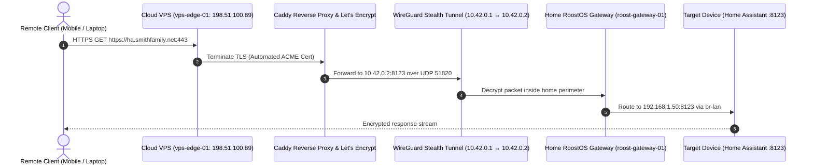
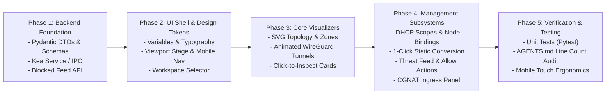

# RoostOS Web UI Redesign: Implementation Specification

**Document Version:** 1.0.0  
**Target Milestone:** RoostOS v0.3.0  
**Status:** Approved for Implementation  
**Working Prototype:** `prototypes/` (tested live at `http://localhost:3300`)  
**Design Standards Reference:** `.agents/AGENTS.md`

---

## 1. Executive Summary & Design Principles

The RoostOS management Web UI redesign replaces the legacy monolithic dashboard with a modular, responsive, multi-persona architecture designed to solve two competing needs:
1. **Power Users & Parents:** Deliver zero-jargon control over family screentime, connected devices, Wi-Fi onboarding, and security shields without requiring network admin expertise.
2. **Network & System Administrators:** Provide instantaneous access to dense telemetry, kernel packet filtering (`nftables`), multi-node cluster settings, ISC Kea DHCP scopes, Edge Gateway CGNAT ingress, and raw configuration files.
3. **Mobile-First Ergonomics:** Seamless usability on smartphones (390px iPhone viewport with sticky bottom tab bars) and tablets (768px iPad viewport).

### Non-Negotiable Coding Standards (`.agents/AGENTS.md`)
* **Strict Modularity:** Maximum 300 lines of code per file across all frontend (`.js`, `.css`) and backend (`.py`) components.
* **Type Safety:** 100% Python type hints and Pydantic models for all DTOs and API schemas.
* **String Formatting:** Python f-strings for all formatting.
* **No Persistent Add Forms:** Never display a permanent "Add" card or side panel on list tables.
* **Inline Editing Row Expansion:** Clicking "Edit" on a table row replaces that row in-place with inline input controls, validation, and Save/Cancel buttons.
* **Top & Bottom Add Buttons:** Every table list features `+ Add [Object]` buttons at both the top and bottom of the table.
* **Inline Add Row Insertion:** Clicking the add button inserts a temporary inline row form at the top/bottom of the table body with identical fields to the editing row.

---

## 2. Information Architecture & Navigation

The application provides two complementary structural modes accessible via the top-level Workspace Selector:

```mermaid
graph TD
    WS["RoostOS Workspace Selector (Header Dropdown)"]
    WS --> C1["Concept 1: Dual-Persona Workspaces"]
    WS --> C2["Concept 2: Unified Progressive Density"]

    subgraph C1_Tree["Concept 1 Workspaces"]
        C1 --> HH["🏡 Household Hub (Friendly)"]
        C1 --> AC["⚡ SysAdmin Console (Technical)"]
        
        HH --> H_Home["Home (Pulse & Actions)"]
        HH --> H_Topo["Network Map (Visual Zones)"]
        HH --> H_Fam["Family (Profiles & Screentime)"]
        HH --> H_Dev["Devices (Directory & Drawer)"]
        HH --> H_Wifi["Wi-Fi (QR & Bands)"]
        HH --> H_Safe["Safety (Blocked Feed & Remote)"]

        AC --> A_Cock["Cockpit (Telemetry & Visualizer)"]
        AC --> A_Topo["Topology & Zones (Fleet Mesh)"]
        AC --> A_Net["Network (Adapters & Cluster)"]
        AC --> A_DHCP["DHCP (Scopes, Nodes & Leases)"]
        AC --> A_Fire["Firewall (nftables & Ports)"]
        AC --> A_DNS["DNS (Technitium & Sinkhole)"]
        AC --> A_Fleet["Fleet (Nodes & Daemons)"]
    end

    subgraph C2_Tree["Concept 2 Progressive Density"]
        C2 --> T_Topo["🌐 Topology (Zones & Mesh)"]
        C2 --> T_Dir["👥 Directory (Grouped Devices)"]
        C2 --> T_Prot["🛡️ Protection (Rules & Blocked Feed)"]
        C2 --> T_Conn["🔌 Connect (Adapters & DHCP)"]
        C2 --> T_Fleet["🖥️ Fleet (Multi-Node Cluster)"]
        
        C2 --> T_Density["Density Toggle: 🌿 Standard vs 🛠️ Expert"]
    end
```



---

## 3. Core Feature Specifications

### 3.1 Interactive Network Topology & Security Zone Visualizer (SVG)
* **Purpose:** Demystify how physical adapters, bridges, VLANs, and VPN tunnels flow into isolated network security zones.
* **Visual Elements:**
  * **The Public Internet & Cloud Endpoints:** Cloud VPS (`vps-edge-01`) and external VPN gateways (`ch45.nordvpn.com`).
  * **Animated WireGuard Tunnels:** Real-time CSS dash-array animations depicting inbound traffic flow on `wg-edge` (CGNAT bypass) and outbound privacy traffic on `wg-privacy`.
  * **Physical Gateway Adapters:** `eth0` (WAN), `eth1` (Trunk), `eth2` (LAN Port), `wlan0` (AP Radio), `wlan1` (Mesh Radio).
  * **Bridge Layer (`br-lan`):** Aggregates physical ports and AP radios into the primary broadcast domain.
  * **VLAN Subinterfaces:** `vlan-guest` (802.1Q Tag 10) and `vlan-iot` (802.1Q Tag 20).
  * **Segmented Security Zones:**
    * 🟢 **Household LAN (`lan`):** Trusted zone, full inter-device communication.
    * 🔵 **Guest Wi-Fi (`guest`):** Client-isolated VLAN 10, WAN NAT only, blocked from LAN/IoT.
    * 🟡 **Smart Home IoT (`iot`):** Isolated VLAN 20, dropped from LAN, blocked inter-client communication.
* **Interactive Element Inspector:**
  * Clicking any port, bridge, zone, or VPN tunnel in the SVG renders an inspector card below with:
    * IP / Subnet allocation.
    * Cipher & encryption method.
    * Real-time transfer throughput (Rx / Tx).
    * Active `nftables` policy rules.
    * Active DHCP pool allocation.
    * **Direct Navigation Action:** A `⚙️ Configure DHCP →` button jumping straight to the authoritative DHCP scope editor.

---

### 3.2 Edge Gateway & CGNAT Bypass Architecture
* **Purpose:** Enable power users and admins to access self-hosted services (Home Assistant, Nextcloud, Plex, Router Web UI) when the home internet is behind Carrier-Grade NAT (RFC 6598 `100.64.0.0/10`) without opening inbound router ports.
* **Data Flow:**



* **UI Presentations:**
  * **Household Hub (`🛡️ Safety`):** Friendly service tiles (`https://ha.smithfamily.net`) with green padlock icons (`🔒 Let's Encrypt Valid`) and 1-tap sharing toggles. Zero networking jargon.
  * **SysAdmin Console (`🔌 Network`):** Complete telemetry panel displaying carrier WAN IP (`100.64.14.82`), public static IPv4 (`198.51.100.89`), WireGuard handshake timer, transfer bytes, ingress proxy routing table, and token generator (`roost-edge-wg://`).

---

### 3.3 Multi-Node Cluster Fleet Network Settings
* **Purpose:** Manage distributed RoostOS deployments spanning specialized hardware (Gateway router, App controller, Mesh satellites, Cloud relays).
* **Cluster Fleet Node Filter:**
  * Present in `Network`, `DHCP`, `Topology`, and `Fleet` tabs:
    `[ 🌐 All Fleet Nodes (4) ]  [ 🛡️ roost-gateway-01 ]  [ 🖥️ roost-controller-01 ]  [ 📶 living-room-ap ]  [ ☁️ vps-edge-01 ]`
* **Adapter Scoping:** Selecting any node filters the network adapter table strictly to that machine's physical and virtual interfaces (e.g. `docker0` on controller, `wlan0/wlan1` on mesh satellite).
* **Node Telemetry:** CPU load, RAM utilization, core thermal sensors, kernel version, and running systemd daemons.

---

### 3.4 Multi-Network DHCP Subsystem (ISC Kea 2.4)
* **Purpose:** Provide authoritative, multi-subnet dynamic IP allocation, lease lifecycle management, host node binding, and static MAC reservations.
* **Naming Standard:** Always labeled as **`📡 DHCP`** across navigation, headers, and tabs.
* **Authoritative Host Node Specification:**
  * Each DHCP scope explicitly declares its **Authoritative Node** (`roost-gateway-01`, `roost-controller-01`).
  * Supports High Availability (`libdhcp_ha.so`): Primary node + optional Standby node (`roost-controller-01` in hot-standby).
* **Multi-Network Scope Configuration Table:**
  * Fields: `Network Scope`, `Authoritative Node`, `Interface`, `Subnet CIDR`, `Gateway IP`, `Dynamic Pool Range` (`poolStart` – `poolEnd`), `Lease Duration`, `Status`.
  * **Inline Edit Row Replacement:** Clicking "Edit" replaces the table row with inline input fields, dropdowns for lease timers (`2h`, `12h`, `24h`, `7d`), host node selector, and Save/Cancel buttons.
  * **Top & Bottom Add Buttons:** Top and bottom `+ Add Network Scope` buttons inserting an inline creation row.
* **Active Dynamic Leases Table:**
  * Real-time list of leased IPs, MAC addresses, client hostnames, remaining lease times, and network interfaces.
  * **1-Click Static Conversion:** A `📌 Convert to Static` button on every dynamic lease row that binds that IP permanently to the static reservations table.
* **Static DHCP Reservations Table:**
  * MAC-to-IP binding list with top/bottom `+ Add Reservation` buttons and inline edit row replacement.

---

### 3.5 Recently Blocked Requests & Live Threat Feed
* **Purpose:** Provide instant visibility into blocked network activity across multiple protection subsystems with 1-click remediation actions.
* **Multi-Subsystem Correlation:**
  1. **DNS Sinkhole (Ad-Block & Telemetry):** Domains blocked by Technitium / blocklists (`ads.google.com`, `telemetry.samsungcloud.com`). Includes a 1-click **"Allow / Whitelist"** button.
  2. **Parental Controls & Bedtimes (`timeguardd`):** Traffic blocked due to screentime caps or active bedtime windows (`Alice's iPad` blocked during bedtime). Includes a 1-click **"+30m Bonus"** button that extends time and unpauses the device.
  3. **Kernel Firewall Drops (`nftables`):** Packets dropped by kernel rules:
     * External WAN port scans dropped at `input_wan`.
     * Quarantined unknown devices (`192.168.1.188`) dropped at `input_quarantine`.
     * IoT lateral movement attempts dropped at `forward_iot_to_lan`.
* **Filtering:** Category pills (`All Blocked`, `Ads & Trackers`, `Bedtime & Screentime`, `Firewall & Isolation`).
* **Placement:**
  * Concept 1 Household Hub: `🛡️ Safety` feed + `🏡 Home` dashboard teaser card.
  * Concept 1 SysAdmin Console: `🔍 DNS` live query stream.
  * Concept 2 Unified Topology: `🛡️ Protection` feed.

---

## 4. Technical Architecture & File Layout

All source code must be organized into modular units strictly **under 300 lines of code**:

```text
roostos/
├── roostos-ui/                        # Frontend Web Application
│   ├── index.html                     # Responsive shell & viewport container
│   ├── css/
│   │   ├── variables.css              # Design tokens, color palette, dark/light themes
│   │   ├── layout.css                 # Responsive grid, header, sticky bottom nav
│   │   └── components.css             # Cards, tables, badges, switches, inline edit rows
│   └── js/
│       ├── app.js                     # Root bootstrap & routing coordinator (< 100 LOC)
│       ├── state.js                   # Reactive store & pub/sub event bus (< 280 LOC)
│       ├── data.js                    # Core data schemas & API bridge (< 290 LOC)
│       ├── blocked-requests-data.js   # Threat feed definitions (< 150 LOC)
│       ├── components/
│       │   ├── blocked-feed.js        # Shared Recently Blocked feed component (< 150 LOC)
│       │   ├── zone-diagram-svg.js    # Interactive SVG network topology diagram (< 295 LOC)
│       │   ├── device-drawer.js       # Device detail slide-over drawer (< 200 LOC)
│       │   └── qr-modal.js            # Guest Wi-Fi QR code modal (< 100 LOC)
│       ├── concept1/                  # Concept 1: Dual-Persona Implementation
│       │   ├── c1-household-home.js   # Friendly home pulse & quick actions (< 250 LOC)
│       │   ├── c1-household-family.js # Family profiles & bedtime sliders (< 200 LOC)
│       │   ├── c1-household-devices.js# Device list with inline edit (< 295 LOC)
│       │   ├── c1-household-wifi.js   # Wi-Fi networks & DHCP IP range card (< 210 LOC)
│       │   ├── c1-household-safety.js # Security shields & remote access (< 160 LOC)
│       │   ├── c1-admin-cockpit.js    # High-density telemetry & WAN sparklines (< 180 LOC)
│       │   ├── c1-admin-network.js    # Cluster fleet adapters & CGNAT panel (< 180 LOC)
│       │   ├── c1-admin-dhcp.js       # Multi-network DHCP scopes & host nodes (< 285 LOC)
│       │   ├── c1-admin-dhcp-leases.js# Dynamic leases & 1-click static bind (< 80 LOC)
│       │   ├── c1-admin-dhcp-res.js   # Static MAC reservations (< 150 LOC)
│       │   ├── c1-admin-firewall.js   # nftables chains & port forwarding (< 220 LOC)
│       │   ├── c1-admin-dns.js        # Technitium forwarders & records (< 180 LOC)
│       │   └── c1-admin-fleet.js      # Multi-node systemd unit health (< 120 LOC)
│       └── concept2/                  # Concept 2: Unified Topology Implementation
│           ├── c2-topology.js         # Topology sub-tab router (< 180 LOC)
│           ├── c2-directory.js        # Grouped device directory (< 260 LOC)
│           ├── c2-protection.js       # Unified protection & threat feed (< 140 LOC)
│           ├── c2-connectivity.js     # Cluster connectivity & Wi-Fi mesh (< 190 LOC)
│           ├── c2-dhcp-scopes.js      # DHCP scopes table with host selectors (< 200 LOC)
│           └── c2-fleet.js            # Distributed cluster telemetry (< 90 LOC)
│
└── roostos-web/                       # Backend FastAPI Service (Python 3.13+)
    └── src/roostos_web/
        ├── routers/
        │   ├── dhcp.py                # Kea DHCP scopes, leases & reservations (< 250 LOC)
        │   ├── network.py             # Cluster nodes, interfaces & bridges (< 260 LOC)
        │   ├── edge.py                # WireGuard CGNAT tunnel & Caddy proxies (< 220 LOC)
        │   ├── protection.py          # Threat feed, ad-blocking & safe search (< 200 LOC)
        │   └── family.py              # Screentime quotas & bedtime schedules (< 220 LOC)
        ├── schemas/                   # Pydantic v2 DTOs (100% Type-Hinted)
        │   ├── dhcp.py                # DhcpScopeDTO, DhcpLeaseDTO, DhcpReservationDTO
        │   ├── network.py             # NodeInterfaceDTO, ClusterNodeDTO, EdgeIngressDTO
        │   └── protection.py          # BlockedRequestDTO, ThreatFeedFilterDTO
        └── services/                  # OS Integration Layer
            ├── kea_service.py         # Subprocess / socket bridge to /etc/kea/ (< 250 LOC)
            ├── nftables_service.py    # Python libnftables / nft JSON parser (< 250 LOC)
            └── wireguard_service.py   # wg-quick / wg show socket manager (< 200 LOC)
```

---

## 5. Backend API & Pydantic Data Models

All backend code strictly complies with `.agents/AGENTS.md` (type hints, f-strings, Pydantic DTOs, `< 300 LOC` per file).

### 5.1 DHCP Schemas (`schemas/dhcp.py`)
```python
from enum import Enum
from pydantic import BaseModel, Field, IPvAnyAddress, field_validator
import re

class HaModeEnum(str, Enum):
    STANDALONE = "standalone"
    HOT_STANDBY = "hot-standby"
    LOAD_BALANCING = "load-balancing"

class DhcpScopeDTO(BaseModel):
    id: str = Field(..., description="Unique scope identifier (e.g. scope-lan)")
    name: str = Field(..., min_length=2, max_length=64, description="Friendly network name")
    node_id: str = Field(..., description="Authoritative cluster node hostname")
    ha_mode: HaModeEnum = Field(default=HaModeEnum.STANDALONE)
    ha_standby_node: str | None = Field(default=None, description="Standby node ID for failover")
    interface: str = Field(..., description="Linux interface/bridge (e.g. br-lan, vlan-iot)")
    subnet: str = Field(..., description="IPv4 CIDR network (e.g. 192.168.1.0/24)")
    gateway: str = Field(..., description="IPv4 Default Gateway IP")
    enabled: bool = Field(default=True)
    pool_start: str = Field(..., description="First dynamic IP in range")
    pool_end: str = Field(..., description="Last dynamic IP in range")
    lease_time_seconds: int = Field(default=86400, ge=600, le=2592000)
    dns_servers: list[str] = Field(default_factory=lambda: ["192.168.1.1"])
    domain_name: str = Field(default="lan.roost")
    authoritative: bool = Field(default=True)

class DhcpLeaseDTO(BaseModel):
    ip: str
    mac: str
    hostname: str
    network_interface: str
    expires_in_seconds: int
    vendor: str | None = None

    @field_validator("mac")
    @classmethod
    def validate_mac(cls, v: str) -> str:
        if not re.match(r"^([0-9A-Fa-f]{2}[:-]){5}([0-9A-Fa-f]{2})$", v):
            raise ValueError(f"Invalid MAC address format: {v}")
        return v.lower()

class DhcpReservationDTO(BaseModel):
    mac: str
    reserved_ip: str
    hostname: str
    zone: str = Field(default="lan")
    description: str | None = None
```

### 5.2 Blocked Requests & Threat Feed Schemas (`schemas/protection.py`)
```python
from enum import Enum
from pydantic import BaseModel, Field
from datetime import datetime

class ThreatSubsystemEnum(str, Enum):
    DNS_SINKHOLE = "DNS Sinkhole"
    TIMEGUARD = "TimeGuard"
    NFTABLES = "nftables"

class ThreatCategoryEnum(str, Enum):
    AD_TRACKER = "Ad & Tracker"
    BEDTIME = "Bedtime Schedule"
    SCREENTIME = "Screentime Limit"
    QUARANTINE = "Device Quarantine"
    PORT_SCAN = "Port Scan"
    ZONE_ISOLATION = "Zone Isolation Violation"

class BlockedRequestDTO(BaseModel):
    id: str
    timestamp: datetime
    client_name: str
    client_ip: str
    target: str
    subsystem: ThreatSubsystemEnum
    category: ThreatCategoryEnum
    rule: str
    action_taken: str
    zone: str
    can_allow: bool = True
    can_bonus: bool = False
    allowed: bool = False
```

### 5.3 FastAPI Endpoints Implementation (`routers/dhcp.py`)
```python
from fastapi import APIRouter, HTTPException, status
from roostos_web.schemas.dhcp import DhcpScopeDTO, DhcpLeaseDTO, DhcpReservationDTO
from roostos_web.services.kea_service import KeaService

router = APIRouter(prefix="/api/v1/dhcp", tags=["DHCP"])
kea_service = KeaService()

@router.get("/scopes", response_model=list[DhcpScopeDTO])
async def list_dhcp_scopes() -> list[DhcpScopeDTO]:
    return await kea_service.get_scopes()

@router.put("/scopes/{scope_id}", response_model=DhcpScopeDTO)
async def update_dhcp_scope(scope_id: str, scope_data: DhcpScopeDTO) -> DhcpScopeDTO:
    if scope_id != scope_data.id:
        raise HTTPException(status_code=400, detail="Scope ID mismatch")
    return await kea_service.update_scope(scope_data)

@router.post("/scopes", response_model=DhcpScopeDTO, status_code=status.HTTP_201_CREATED)
async def create_dhcp_scope(scope_data: DhcpScopeDTO) -> DhcpScopeDTO:
    return await kea_service.create_scope(scope_data)

@router.get("/leases", response_model=list[DhcpLeaseDTO])
async def get_active_leases(node_id: str | None = None) -> list[DhcpLeaseDTO]:
    return await kea_service.get_leases(node_id=node_id)

@router.post("/reservations/from-lease", response_model=DhcpReservationDTO)
async def convert_lease_to_reservation(mac: str) -> DhcpReservationDTO:
    reservation = await kea_service.convert_lease_to_static(mac)
    if not reservation:
        raise HTTPException(status_code=404, detail=f"No active lease found for MAC {mac}")
    return reservation
```

---

## 6. Phased Implementation Roadmap



### Phase 1: Backend Foundation & Daemon Drivers
* Implement Pydantic DTOs in `roostos-web/src/roostos_web/schemas/`.
* Implement `kea_service.py` to parse and update `/etc/kea/kea-dhcp4.conf` and read `/var/lib/kea/kea-leases4.csv`.
* Add the `/api/v1/blocked-requests` endpoint aggregating DNS query logs and `nftables` drop counters.

### Phase 2: Web UI Shell, State Store & Design Tokens
* Establish shared CSS tokens (`var(--bg-canvas)`, `var(--brand-primary)`, `var(--radius-md)`).
* Implement `state.js` reactive store and pub/sub event bus with mutation handlers.
* Build the responsive viewport wrapper supporting fluid desktop and 390px mobile notch frames.

### Phase 3: Interactive Network Topology & Zone Visualizer
* Implement `zone-diagram-svg.js` with responsive SVG viewBox (`0 0 920 490`).
* Embed CSS animation for WireGuard tunnel packet streams (`stroke-dasharray`).
* Connect click events on SVG nodes to update the inspector card and navigate to DHCP/Interface settings.

### Phase 4: Subsystem Editors & AGENTS.md Behaviors
* Build `c1-admin-dhcp.js` with cluster host node selector pills, inline edit replacement, and top/bottom add buttons.
* Build `c1-blocked-feed.js` with category filters and instant allow/bonus triggers.
* Integrate the Edge Gateway CGNAT bypass panel with stealth WireGuard telemetry and Caddy reverse proxies.

### Phase 5: Production Verification & Quality Assurance
* Audit all source files to verify strictly `< 300 lines of code`.
* Verify that no persistent add forms exist across any table list.
* Validate mobile touch targets (minimum 44x44px for buttons, bottom navigation visibility).

---

## 7. Acceptance Criteria

| ID | Test Criterion | Verification Method |
| :--- | :--- | :--- |
| **AC-01** | Line count compliance across 100% of files | Automated CI check: `wc -l` fails if any `.js` or `.py` file $\ge 300$ lines. |
| **AC-02** | No persistent add forms on any list table | Visual and DOM inspection confirms zero static add cards adjacent to tables. |
| **AC-03** | Inline edit row replacement | Clicking "Edit" replaces `<tr>` in-place with inputs, `<select>`, and inline Save/Cancel. |
| **AC-04** | Top and bottom add buttons | Every table contains `+ Add [Object]` buttons at both top action bar and footer. |
| **AC-05** | Inline add row insertion | Clicking add button inserts temporary row form at top/bottom of `<tbody>`. |
| **AC-06** | Multi-node DHCP host binding | User can assign a subnet scope to `roost-gateway-01` or `roost-controller-01`. |
| **AC-07** | 1-Click lease to static reservation | Clicking "Convert to Static" immediately adds the device to the static reservations table. |
| **AC-08** | Interactive SVG Topology inspection | Clicking `br-lan` or security zones displays telemetry and "Configure DHCP" button. |
| **AC-09** | Recently Blocked feed functionality | Clicking "Allow" whitelists the domain; clicking "+30m" grants screentime bonus. |
| **AC-10** | Mobile responsiveness | 390px viewport renders sticky bottom navigation bar and full-width touch cards. |
